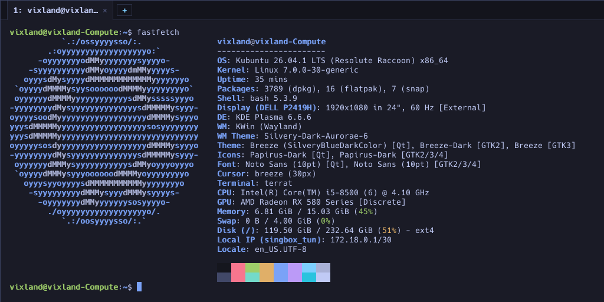

<p align="center">
  
</p>

<h1 align="center">Terrat</h1>

<p align="center">
  <b>A terminal emulator for Linux, written in pure Go. No CGO.</b>
  <br>
  <i>v3.0.3 &bull; X11 / XWayland</i>
</p>

<p align="center">
  <a href="#why-another-terminal">Why</a> &bull;
  <a href="#what-it-does">Features</a> &bull;
  <a href="#keyboard-shortcuts">Shortcuts</a> &bull;
  <a href="#usage">Usage</a> &bull;
  <a href="#configuration">Configuration</a> &bull;
  <a href="#install">Install</a> &bull;
  <a href="#benchmarks">Benchmarks</a> &bull;
  <a href="#license">License</a>
</p>

<p align="center">
  
</p>

---

## Why another terminal?

Because I wanted one I could actually read. Most terminals are either huge C/C++ projects with decades of baggage, or Electron apps that eat half a gigabyte just to show you a prompt.

Terrat is a single Go binary. No CGO, no runtime dependencies, no 400 MB install. It starts fast, stays out of the way, and does the few things a terminal should do — well.

It won't replace Alacritty or Kitty for everyone. It will open instantly, keep your tabs in order, and fix your typos before you hit Enter.

## What it does

### Tabs that behave

Every tab is its own PTY with its own shell. The tab shows what it's running — `bash`, `nvim`, `htop` — so you can find things at a glance. Close the last tab and the window goes with it. Drag any edge to resize; the running program gets a `SIGWINCH` and reflows like it should.

### It reads what you type

Type `gti` and Terrat quietly offers `git`. Type `git puch` and it offers `git push`. It checks commands, subcommands, quotes, and separators (`&&`, `||`, `;`, `|`), and it will flag a command that probably wants `sudo` before you run it. File paths are left alone.

`Alt+Enter` applies the fix. `Ctrl+Shift+D` turns the whole thing off if you'd rather make your own mistakes.

History and path suggestions come from your own shell history (`~/.bash_history` or `~/.zsh_history`). `Tab` or `Right Arrow` accepts one. Paths with spaces, quotes, and `~` all complete properly.

### Search the scrollback

`Ctrl+Shift+F` searches the whole scrollback, not just the visible screen. Matches are highlighted; `Enter` and `Shift+Enter` jump between them.

### Copy, paste, and the clipboard, properly

Double-click a word, triple-click a line, drag to select. `Ctrl+Shift+C` copies, `Ctrl+Shift+V` pastes, `Ctrl+Shift+A` selects everything. Middle-click pastes from the X11 primary selection, like it always has.

Paste is bracketed, so pasted text can't run commands on its own. With sanitizing on, escape sequences and bidirectional override characters are stripped out of pastes — the tricks used for pastejacking and for hiding malicious text in plain sight. The zero-width non-joiner (`U+200C`) is preserved, so Persian text pastes intact.

Big copies work too: copying or pasting around a megabyte goes through the X11 INCR protocol instead of silently truncating.

### Text that lines up

CJK characters and emoji take two cells. Combining marks and the ZWNJ take zero. Your prompt doesn't drift sideways after an emoji, and `vim` doesn't lose track of where the cursor is.

### Themes

`Ctrl+,` or `Ctrl+Shift+P` opens Preferences: Tokyo Night, Catppuccin Mocha, Minecraft (with blocky titlebar buttons, obviously), Tokyo Day, and Solarized Light — listed as "Solarized". Auto follows your desktop theme when it can tell what that is.

### Mouse and keyboard, the boring parts that have to work

The scrollbar drags, and clicking the track jumps where you click. Dead keys and AltGr work on international layouts — on us-intl, `´` + `e` gives `é` and `AltGr` + `5` gives `€`. Font size is `Ctrl+=` / `Ctrl+-`, reset with `Ctrl+0`, or hold `Ctrl` and scroll. `Shift+PageUp` / `Shift+PageDown` scroll the viewport.

---

## Keyboard shortcuts

### Navigation & tabs
| Shortcut | Action |
| :--- | :--- |
| `Ctrl + Shift + T` | Open new tab |
| `Ctrl + Shift + W` | Close active tab |
| `Ctrl + Tab` / `Ctrl + PageDown` | Switch to next tab |
| `Ctrl + Shift + Tab` / `Ctrl + PageUp` | Switch to previous tab |
| `Alt + 1` .. `Alt + 9` | Jump directly to tabs 1 through 9 |

### Clipboard & selection
| Shortcut | Action |
| :--- | :--- |
| `Ctrl + Shift + C` *(or `Ctrl + C` with selection)* | Copy selected text to clipboard |
| `Ctrl + Shift + V` / `Shift + Insert` | Paste text from clipboard |
| `Ctrl + Shift + A` | Select entire terminal buffer |
| `Middle Click` | Paste from X11 `PRIMARY` selection |

### Diagnostics & search
| Shortcut | Action |
| :--- | :--- |
| `Alt + Enter` | Apply a command suggestion |
| `Ctrl + Shift + D` | Toggle command diagnostics |
| `Tab` / `Right Arrow` | Accept the completion suggestion |
| `Ctrl + Shift + F` | Toggle in-buffer search bar |
| `Enter` / `Shift + Enter` | Next / previous search match |
| `Esc` | Close search bar or preferences modal |
| `Ctrl + Left Click` | Open hovered URL in default browser |

### View & font zoom
| Shortcut | Action |
| :--- | :--- |
| `Ctrl + =` / `Ctrl + +` | Increase font size by 1pt |
| `Ctrl + -` / `Ctrl + _` | Decrease font size by 1pt |
| `Ctrl + 0` | Reset font size to default (13pt) |
| `Ctrl + Wheel Up / Down` | Zoom in / out with mouse wheel |
| `Shift + PageUp / PageDown` | Scroll terminal viewport up / down |
| `Ctrl + ,` / `Ctrl + Shift + P` | Open / close Preferences modal |

---

## Usage

```bash
terrat [flags] [-e command [args...]]
```

### Options
| Flag | Description | Default |
| :--- | :--- | :--- |
| `-v`, `-version` | Print version information and exit | `false` |
| `-title <string>` | Set initial window title | `TerraTerminal` |
| `-font-size <float>` | Override font size in points | *(config)* |
| `-theme <string>` | Color theme (`tokyo-night`, `catppuccin-mocha`, `minecraft`, `tokyo-day`, `solarized-light`) | *(config)* |
| `-shell <path>` | Override default shell binary (e.g. `bash`, `zsh`) | *(system)* |
| `-e <cmd...>` | Execute a custom command directly instead of the default shell | &mdash; |

### Examples
```bash
# Set the font size and theme
terrat -font-size 15 -theme catppuccin-mocha

# Run a command instead of a shell
terrat -e htop
terrat -e nvim /path/to/file
```

---

## Configuration

Settings are saved automatically to `$XDG_CONFIG_HOME/terrat/config.json`, usually `~/.config/terrat/config.json`. For a portable install, place `config.json` beside the executable; that file takes precedence over the user configuration.

Default settings:

```json
{
  "shell": "",
  "theme": "auto",
  "font_size": 13.0,
  "opacity": 0.95,
  "ghost_text": true,
  "diagnostics": true,
  "sanitize_paste": true,
  "bracketed_paste": true
}
```

---

## Install

### Packages

Grab the latest release — `.deb`, `.rpm`, `.pkg.tar.zst`, and `.tar.gz` for amd64 and arm64, plus plain binaries:

https://github.com/Kouroxsh/Terrat/releases/latest

### From source

```bash
# Clone the repository
git clone https://github.com/Kouroxsh/Terrat.git
cd Terrat

# Build the binary
make build

# Install to ~/go/bin, with a desktop entry and icon
make install

# Build Linux release packages (.deb, .rpm, .pkg.tar.zst, .tar.gz) via nfpm
make package
```

You need Go 1.23 or newer, and X11 or Wayland with XWayland. `make package` needs `nfpm` installed separately.

### Tests & static analysis

```bash
# Run unit and race detection test suite
go test -race -count=1 ./...

# Run static analysis
go vet ./...
```

---

## Benchmarks

Median of five runs · AMD EPYC 9D25 (cloud VM) · Linux/amd64 · Go 1.23.0.

| Operation | Result | Allocations |
| :--- | ---: | ---: |
| Write 128 plain terminal lines | 150.5 µs | 0 B/op |
| Write 128 ANSI-colored terminal lines | 183.2 µs | 2 KB/op |
| Write 128 alternate-screen lines | 146.6 µs | 0 B/op |
| Render a 1024 × 640 frame | 989.9 µs | 32 B/op |
| Render a 1024 × 640 frame with search matches | 2.21 ms | 32 B/op |
| Fill a 1024 × 640 canvas | 57.3 µs | 0 B/op |
| Create and close the font engine | 1.53 ms | 703 KB/op |
| Add an entry to shell history | 0.1 µs | 0 B/op |

The write benchmarks send 128 lines after warming up the terminal. The render benchmarks measure drawing to an in-memory CPU canvas; X11 presentation and window composition are excluded. These measurements do not cover shell startup, whole-app latency, or resident memory use.

To run the benchmarks:

```bash
go test ./internal/terminal ./internal/render ./internal/autosuggest -run '^$' -bench . -benchmem -benchtime=500ms -count=5
```

---

## What it doesn't do (yet)

- No Arabic-script shaping: Persian and Arabic text renders as replacement glyphs for now. Widths are correct (ZWNJ is zero-width), shaping is a separate job.
- No native Wayland backend — it runs through XWayland.
- No split panes yet. Tabs only.

---

## License

[MIT](LICENSE).
