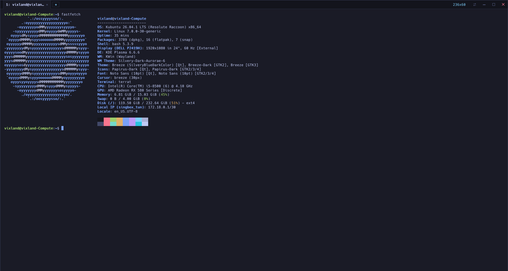

<p align="center">
  
</p>

<h1 align="center">TerraTerminal (<code>terrat</code>)</h1>

<p align="center">
  <b>A terminal emulator for Linux, written in Go.</b>
  <br>
  <i>v3.0.0 &bull; X11 / XWayland &bull; No CGO required</i>
</p>

<p align="center">
  <a href="#overview">Overview</a> &bull;
  <a href="#features">Features</a> &bull;
  <a href="#keyboard-shortcuts">Shortcuts</a> &bull;
  <a href="#cli-usage">CLI Usage</a> &bull;
  <a href="#configuration">Configuration</a> &bull;
  <a href="#installation--building">Installation</a> &bull;
  <a href="#benchmarks">Benchmarks</a> &bull;
  <a href="#license">License</a>
</p>

<p align="center">
  
</p>

---

## Overview

TerraTerminal (`terrat`) runs on Linux with X11 or XWayland. It is written in Go and can be built without CGO.

It has tabs, text search, themes, and suggestions from shell history. Command diagnostics catch common typos as you type. Each tab keeps its own shell session and terminal state.

---

## Features

### Window and tabs

The titlebar has settings, minimize, maximize, and close buttons. Drag any edge or corner to resize the window.

Each tab runs a separate pseudo-terminal (PTY). Tabs show the running process name, such as `bash`, `nvim`, or `htop`. Open, close, and switch tabs from the tab bar or with the shortcuts below. Closing the last tab exits TerraTerminal.

### Text and search

Change the font size with `Ctrl+=`, `Ctrl+-`, or `Ctrl + MouseWheel`. Glyphs are cached, with system fonts used as fallbacks. Box-drawing characters are supported. Resizing updates the PTY dimensions and notifies the running program with `SIGWINCH`.

Press `Ctrl+Shift+F` to search the terminal buffer. Matches are highlighted; `Enter` and `Shift+Enter` move between them.

**Current limitation:** Persian and Arabic display is disabled. Arabic-script glyphs appear as replacement characters, and right-to-left layout is unsupported.

### Themes

Open Preferences with `Ctrl+,` or `Ctrl+Shift+P` to choose a theme:

- Tokyo Night, Catppuccin Mocha, and Minecraft are dark themes. Minecraft also changes the titlebar buttons to a block style.
- Tokyo Day and Solarized Light are light themes. Solarized Light is listed as “Solarized” in Preferences.
- Auto follows the desktop theme when detection is available.

### Command suggestions

Diagnostics check commands, subcommands, quotes, and separators (`&&`, `||`, `;`, `|`). They suggest corrections such as `gti` → `git` and `git puch` → `git push`, and can flag commands that may need elevated privileges. File paths are skipped by diagnostics.

Press `Alt+Enter` to apply a correction. Toggle diagnostics with `Ctrl+Shift+D`.

History suggestions come from `~/.bash_history` or `~/.zsh_history`. Path completion handles spaces, quoted paths, and `~`. Accept a history or path suggestion with `Tab` or `Right Arrow`.

### Selection and paste

Double-click to select a word; triple-click to select a line. `Ctrl+C` copies selected text. With no selection, it sends an interrupt. `Ctrl+V` pastes in the shell and in fullscreen editors such as `vim` and `nano`.

Bracketed paste is available for programs that support it. Paste cleanup removes terminal escape sequences and bidirectional override characters when enabled. Other text, including the zero-width non-joiner (`U+200C`), is preserved.

---

## Keyboard Shortcuts

### Navigation & Tabs
| Shortcut | Action |
| :--- | :--- |
| `Ctrl + Shift + T` | Open new tab |
| `Ctrl + Shift + W` | Close active tab |
| `Ctrl + Tab` / `Ctrl + PageDown` | Switch to next tab |
| `Ctrl + Shift + Tab` / `Ctrl + PageUp` | Switch to previous tab |
| `Alt + 1` .. `Alt + 9` | Jump directly to tabs 1 through 9 |

### Clipboard & Selection
| Shortcut | Action |
| :--- | :--- |
| `Ctrl + Shift + C` *(or `Ctrl + C` with selection)* | Copy selected text to clipboard |
| `Ctrl + Shift + V` / `Shift + Insert` | Paste text from clipboard |
| `Ctrl + Shift + A` | Select entire terminal buffer |
| `Middle Click` | Paste from X11 `PRIMARY` selection |

### Diagnostics & Search
| Shortcut | Action |
| :--- | :--- |
| `Alt + Enter` | Apply a command suggestion |
| `Ctrl + Shift + D` | Toggle command diagnostics |
| `Tab` / `Right Arrow` | Accept the completion suggestion |
| `Ctrl + Shift + F` | Toggle in-buffer search bar |
| `Enter` / `Shift + Enter` | Next / previous search match |
| `Esc` | Close search bar or preferences modal |
| `Ctrl + Left Click` | Open hovered URL in default browser |

### View & Font Zoom
| Shortcut | Action |
| :--- | :--- |
| `Ctrl + =` / `Ctrl + +` | Increase font size by 1pt |
| `Ctrl + -` / `Ctrl + _` | Decrease font size by 1pt |
| `Ctrl + 0` | Reset font size to default (13pt) |
| `Ctrl + Wheel Up / Down` | Zoom in / out with mouse wheel |
| `Shift + PageUp / PageDown` | Scroll terminal viewport up / down |
| `Ctrl + ,` / `Ctrl + Shift + P` | Open / close Preferences modal |

---

## CLI Usage

```bash
terrat [flags] [-e command [args...]]
```

### Options
| Flag | Description | Default |
| :--- | :--- | :--- |
| `-v`, `-version` | Print version information and exit | `false` |
| `-title <string>` | Set initial window title | `TerraTerminal` |
| `-font-size <float>` | Override font size in points | *(config)* |
| `-theme <string>` | Color theme (`tokyo-night`, `catppuccin-mocha`, `minecraft`, `tokyo-day`, `solarized-light`) | *(config)* |
| `-shell <path>` | Override default shell binary (e.g. `bash`, `zsh`) | *(system)* |
| `-e <cmd...>` | Execute a custom command directly instead of the default shell | &mdash; |

### Examples
```bash
# Set the font size and theme
terrat -font-size 15 -theme catppuccin-mocha

# Run a command instead of a shell
terrat -e htop
terrat -e nvim /path/to/file
```

---

## Configuration

Settings are saved automatically to `$XDG_CONFIG_HOME/terrat/config.json`, usually `~/.config/terrat/config.json`. For a portable install, place `config.json` beside the executable; that file takes precedence over the user configuration.

Default settings:

```json
{
  "shell": "",
  "theme": "auto",
  "font_size": 13.0,
  "opacity": 0.95,
  "ghost_text": true,
  "diagnostics": true,
  "sanitize_paste": true,
  "bracketed_paste": true
}
```

---

## Benchmarks

Results from five runs on Linux/amd64, using Go 1.22.6 and an Intel Core i5-8500 @ 3.00 GHz. Each row shows the median time per operation and its allocations.

| Operation | Result | Allocations |
| :--- | ---: | ---: |
| Write 128 plain terminal lines | 95.3 µs | 0 B/op, 0 allocs/op |
| Write 128 ANSI-colored terminal lines | 119.4 µs | 2,048 B/op, 512 allocs/op |
| Write 128 alternate-screen lines | 89.0 µs | 0 B/op, 0 allocs/op |
| Render a 1024 × 640 frame | 973 µs | 32 B/op, 3 allocs/op |
| Render a 1024 × 640 frame with search matches | 2.06 ms | 32 B/op, 3 allocs/op |
| Fill a 1024 × 640 canvas | 70.8 µs | 0 B/op, 0 allocs/op |
| Create and close the font engine | 1.96 ms | 677,434 B/op, 1,199 allocs/op |
| Add an entry to shell history | 42.4 ns | 0 B/op, 0 allocs/op |

The write benchmarks send 128 lines after warming up the terminal. The render benchmarks measure drawing to an in-memory CPU canvas; X11 presentation and window composition are excluded. These measurements do not cover shell startup, whole-app latency, or resident memory use.

To run the benchmarks:

```bash
go test ./internal/terminal ./internal/render ./internal/autosuggest -run '^$' -bench . -benchmem -benchtime=500ms -count=5
```

---

## Installation & Building

### Prerequisites
- **Linux:** X11 server or Wayland via XWayland.
- **Go 1.22.6+** (only required if compiling from source).

### Building from Source

```bash
# Clone the repository
git clone https://github.com/Kouroxsh/Terrat.git
cd Terrat

# Build the binary
make build

# Install to ~/go/bin, with a desktop entry and icon
make install

# Build Linux release packages (.deb, .rpm, .pkg.tar.zst, .tar.gz) via nfpm
make package
```

Packaging requires `nfpm`. If it is missing, the script tries to install it with `go install`.

### Running Tests & Static Analysis

```bash
# Run unit and race detection test suite
go test -race -count=1 ./...

# Run static analysis
go vet ./...
```

---

## License

[MIT](LICENSE).
